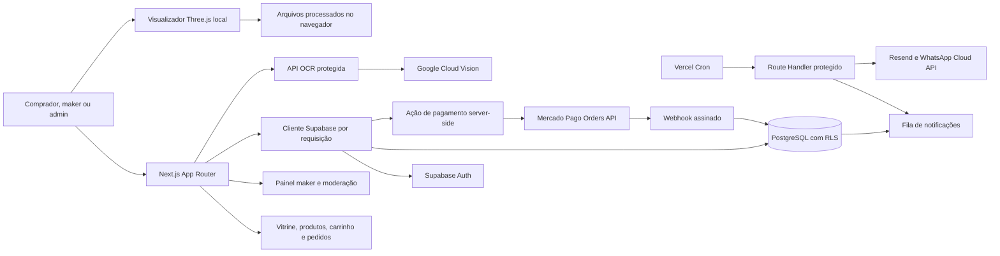

# Arquitetura atual

## Direção

Next.js App Router com TypeScript, páginas renderizadas no servidor e componentes client apenas para interações que precisam de estado local ou WebGL. Supabase fornece Auth e PostgreSQL com RLS. Integrações externas rodam no servidor; OAuth do Mercado Pago vincula contas de vendedores com PKCE e tokens criptografados. O Checkout Pro Orders processa pedidos de carrinho, compras diretas e propostas de impressão aceitos por loja. Para pedidos de carrinho, o vendedor pode consultar tarifas Melhor Envio ou informar o frete manualmente; etiquetas Melhor Envio exigem confirmação explícita do custo pelo vendedor e atualizam o rastreio via webhook assinado.

## Fluxos implementados

- Homepage pública com busca, categorias, paginação, páginas de produto e metadados para indexação.
- A galeria `/modelos` organiza prévias dos 94 arquivos 3MF únicos do proprietário em sete categorias; busca por texto, tags e imagem. Os arquivos originais ainda não foram vinculados a uma loja aprovada para venda.
- Diretório público `/lojas` e páginas individuais de fabricantes aprovados, com marca visual, localização aproximada, descrição, anúncios, prazos por produto, políticas comerciais e avaliações moderadas.
- Supabase Auth com cadastro, confirmação, login e saída; compradores podem solicitar acesso maker e admins aprovam perfis, lojas e anúncios.
- Compradores autenticados enviam pedidos de orçamento e solicitações individuais de compra. O fabricante pode propor preço para orçamento e confirmar ou recusar disponibilidade para compra.
- Compradores autenticados também enviam pedidos personalizados para modelos salvos. Lojas com equipamento disponível, compatibilidade técnica publicada e volume suficiente recebem o pedido, podem enviar propostas concorrentes e o comprador escolhe uma. Após a escolha, o comprador seleciona um endereço salvo; somente a loja vencedora pode lê-lo, cotar manualmente o frete e incluí-lo no checkout. Depois do pagamento confirmado, a loja inicia e conclui a produção, registra o rastreio e o comprador confirma a entrega. O banco bloqueia o início até confirmar o pagamento. Os arquivos ficam em bucket privado e são acessados por link assinado curto somente durante a participação.
- Compradores autenticados salvam e removem produtos publicados em `/favoritos`; favoritos são privados por comprador e não incluem dados de demonstração.
- Produtos de preço fixo também podem ser reunidos em carrinho persistente. O fechamento valida preços e disponibilidade no banco e cria um pedido separado por loja; após a loja confirmar disponibilidade e oferecer frete por cotação Melhor Envio ou manual, o comprador aceita e paga produtos mais frete pelo Mercado Pago. A comissão incide no subtotal dos produtos. Para etiquetas Melhor Envio, o vendedor informa NF-e e dados de envio, adiciona o frete ao carrinho do provedor e confirma o valor antes do débito da própria carteira; eventos do webhook assinado atualizam o estado e o rastreio. O comprador confirma o recebimento. Solicitações diretas de compra aceitas também podem iniciar checkout e reservar estoque contado.
- Produtos físicos de preço fixo podem anunciar até quatro grupos de opções, como cor e tamanho. Cada uma das até 100 combinações pode ter preço e estoque próprios; a vitrine, o carrinho e a compra direta mostram e validam a combinação selecionada. Os itens do pedido guardam o identificador, as opções e o preço unitário como snapshot.
- Fabricantes definem pronta entrega ou produção sob encomenda, acompanham estoque contado e prazo de preparação; o banco rejeita quantidades maiores que o estoque publicado.
- Fabricantes podem solicitar reembolsos totais ou parciais no extrato; o banco reserva o saldo por cobrança e o Mercado Pago recebe uma chave de idempotência que permite repetir uma tentativa pendente sem emitir outro estorno.
- Compradores podem cancelar orders ainda não pagas em `/orcamentos`; o portal confere a order no Mercado Pago e libera estoque reservado somente após confirmação.
- Fabricantes registram data ou horímetro previsto de manutenção por componente; o painel destaca agendas vencidas e próximas usando apenas os dados informados pela própria loja.
- Compradores salvam endereços privados, definem um endereço principal e podem editá-los/removê-los; a exclusão do principal promove outro endereço automaticamente.
- No checkout, compradores escolhem um endereço salvo; cada pedido por loja recebe um snapshot de entrega visível ao comprador e ao fabricante responsável para combinar o envio.
- Painel maker lista solicitações e pedidos, contatos de notificação, anúncios, equipamentos próprios com manutenção, lotes de consignação agrupados por estabelecimento e perfis privados/comunitários de impressão.
- Revisão administrativa aprova perfis submetidos como comunitários ou oficiais; páginas públicas leem somente perfis publicados ligados a produtos e lojas publicados.
- Administradores gerenciam destaques da homepage em `/admin/banners`; os seis primeiros ativos pela ordem configurada aparecem na vitrine. Destinos são limitados a caminhos internos e imagens exigem HTTPS e texto alternativo.
- Administradores criam e editam categorias do marketplace em `/admin/categorias`; categorias com anúncios publicados não podem ser desativadas.
- Fabricantes editam descrição, logo, banner, cidade/UF e políticas comerciais pelo painel; somente lojas aprovadas são listadas e indexáveis, e as páginas de produto e a homepage levam às vitrines.
- Compradores podem avaliar lojas e produtos após pedidos do carrinho concluídos, compras diretas pagas e arquivos digitais pagos; impressões personalizadas podem receber avaliação da loja depois de pagas e concluídas. Avaliações ficam pendentes até aprovação em `/admin/avaliacoes`; páginas públicas exibem apenas as aprovadas e não identificam o comprador.
- Administradores cadastram e revisam modelos mestres de impressoras em `/admin/catalogos/impressoras`, com referências HTTPS e data de conferência obrigatórias para publicar.
- Fabricantes podem sugerir modelos ausentes do catálogo; a curadoria administrativa aprova ou recusa e aprovação cria apenas um rascunho revisável.
- Administradores cadastram materiais, resinas, bicos e relações de compatibilidade em `/admin/catalogos/materiais` e `/admin/catalogos/bicos`; cada vínculo publicado requer fonte HTTPS e data de conferência.
- E-mail e WhatsApp usam fila persistente com tentativas; WhatsApp depende de consentimento do maker e template aprovado.
- `/catalogos` consulta os registros publicados no banco quando disponíveis e usa dados locais de referência quando não há conexão.
- `/visualizador` lê arquivos STL, OBJ, 3MF, GLB e GLTF localmente no navegador; compradores podem salvar conjuntos validados no Supabase Storage privado e reabri-los depois. `/calculadora` estima custos e preços por canal; makers salvam snapshots privados e, se Cloud Vision estiver configurado, leem capturas de tela com consentimento.
- O histórico de custos pode ser associado a um anúncio e ao equipamento principal da própria loja sem alterar o snapshot recalculado; os vínculos são validados no servidor e na política RLS.
- `/admin` reúne indicadores brutos do marketplace, contagens das filas pendentes (fabricantes, lojas, anúncios, perfis, designers, denúncias, avaliações e sugestões de impressora) e atalhos para as ferramentas administrativas existentes. As filas usam a sessão autenticada e as políticas RLS; a RPC financeira é acessada pelo servidor após verificar papel admin e só pode ser executada com `service_role`.
- Administradores podem baixar `/api/admin/reports` como CSV; o endpoint verifica o papel antes de consultar a RPC financeira com `service_role`, desativa cache e identifica os valores como brutos, sem conciliação de liquidação ou receita líquida.
- Compradores, fabricantes e designers abrem tickets privados em `/suporte`, acompanham mensagens e respondem; administradores gerenciam status e respondem em `/admin/atendimento`, com contagem de pendências no painel administrativo. A fila prioriza os 100 casos mais antigos em aberto/análise e mostra até 100 casos recentes aguardando usuário, resolvidos ou encerrados; ainda não há prazos ou alertas de SLA.

## Limites atuais

- As 67 migrações versionadas foram aplicadas ao projeto Supabase `drblsfcahfniwusfblfw`; testes de ponta a ponta com contas sandbox ainda faltam. Pagamentos reais dependem de credenciais Mercado Pago, comissão configurada, webhook ativo e validação sandbox.
- Pedidos aceitos e pagos do carrinho podem consultar tarifas Melhor Envio, criar uma etiqueta após o vendedor informar a chave NF-e, telefone/CPF do destinatário e uma embalagem, e sincronizar o rastreio pelo webhook HMAC. O portal processa esses dados para a chamada e não armazena chave NF-e ou CPF; neste fluxo é suportada uma embalagem por pedido. A operação ainda depende de credenciais, reconexão OAuth dos vendedores com escopos de checkout, registro do webhook no painel Melhor Envio e validação sandbox. Impressões personalizadas seguem com cotação manual. O atendimento é uma caixa interna com anexos privados, tempo desde a última atualização e média administrativa da primeira resposta em períodos de 7/30 dias; metas de SLA e alertas ainda não foram definidos. Endereços são snapshots privados por pedido.
- Lembretes de manutenção dependem de o fabricante registrar datas/horímetros; o portal não infere intervalos nem apresenta recomendações do fabricante do equipamento.
- Banners aceitam mídia HTTPS externa com carregamento tardio e texto alternativo; upload gerenciado e otimização de imagem ainda não estão conectados.
- O visualizador não preserva atribuições reais de filamento por cor. A calculadora importa peso e tempo por OCR e exibe dados reconhecidos, incluindo filamentos por cor, purga e torre; isso depende de Cloud Vision configurado e rótulos legíveis. Imagens e texto OCR não entram no histórico e a interpretação requer confirmação do fabricante.
- Catálogos técnicos recebem verificação semanal dos cabeçalhos HTTP de fontes oficiais e alertas para revisão administrativa. Quando faltam `ETag`/`Last-Modified`, o sistema calcula SHA-256 de HTML, texto ou PDF até 512 KiB, seguindo somente redirecionamentos para hosts permitidos; conteúdos maiores ou de outro tipo continuam sinalizados como não verificáveis. O hash detecta mudanças, mas não extrai nem atualiza especificações: toda alteração exige revisão administrativa. Alterações administrativas guardam snapshots das versões anteriores. A descoberta automática de modelos novos e a curadoria de relações de compatibilidade continuam pendentes; telas administrativas exibem até 250 registros por categoria/relação.
- Designers podem solicitar e editar um portfólio em `/conta`; a aprovação concede acesso de maker e cria uma loja pendente, que a equipe publica em `/admin/fabricantes`. Só perfis aprovados aparecem em `/designers` e no sitemap. Anúncios digitais usam arquivos STL/3MF privados, cópia GLB de prévia interativa, licenças pessoais/comerciais, compra via checkout, links temporários de download e histórico; denúncias vão para `/admin/denuncias-digitais`. O arquivo original não é usado como prévia: o GLB fica privado no Storage e a página pública recebe um link assinado temporário para visualizá-lo. Fabricantes têm extrato das 500 cobranças mais recentes com totais pagos e comissão, além de `/painel/maker/relatorios`, que resume pedidos do carrinho por status e o volume de orçamentos e impressões por data de criação nos últimos 7 e 30 dias e permite exportar a própria tabela em CSV, restrita à loja autenticada; esse resumo não representa receita. Ainda faltam conciliação financeira, relatórios administrativos detalhados e dados de liquidação/repasse do provedor. O painel administrativo apresenta totais brutos, sem afirmar receita líquida ou repasse. Solicitações de impressão personalizada mostram histórico de convites, propostas, decisões, cancelamento, etapas de produção e entrega para comprador e fabricante autorizado; frete é cotado manualmente pela loja vencedora e o rastreio é informado no painel. Checkout Pro de pedidos aceitos do carrinho e compras diretas reserva estoque contado; a impressão personalizada só avança para produção depois do pagamento confirmado. O controle de consignação mantém estoque estimado por estabelecimento, sem conciliação com pedidos ou pagamentos.
- A `proxy.ts` atualiza cookies e claims da sessão. Cada página e Server Action privada também verifica o papel do usuário; RLS permanece a fronteira de dados no banco. Reembolsos pendentes são conciliados diariamente. Fabricantes acompanham contestações no extrato e podem enviar evidências ao Mercado Pago enquanto o caso permanece aberto; o portal ainda não administra decisões de disputa.

## Próximas integrações

1. Validar os fluxos do portal contra o esquema Supabase aplicado e executar compras de teste ponta a ponta.
2. O primeiro lote de 14 novos modelos de impressora está em `20261112130331_seed_official_printer_catalog.sql`; relações entre os novos modelos, materiais e bicos ainda precisam de curadoria antes de serem anunciadas como compatíveis.
3. Ligar históricos de manutenção a materiais/produtos; a calculadora identifica filamentos e resinas pelo catálogo e avalia as condições técnicas do material para o modelo de impressora vinculado. O preço de compra continua informado pelo fabricante, e a manutenção usa a média dos custos registrados por hora acumulada.
4. Configurar e validar em sandbox o aplicativo e o webhook Melhor Envio; homologar pedido com NF-e, compra de etiqueta, impressão privada e atualização de rastreio.
5. Validar pagamentos sandbox antes de qualquer cobrança real e completar conciliação financeira e relatórios administrativos detalhados; `/admin/auditoria` registra mudanças de status moderadas pelo portal.
