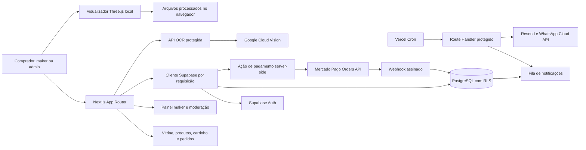

# Arquitetura atual

## Direção

Next.js App Router com TypeScript, páginas renderizadas no servidor e componentes client apenas para interações que precisam de estado local ou WebGL. Supabase fornece Auth e PostgreSQL com RLS. Integrações externas rodam no servidor; OAuth do Mercado Pago vincula contas de vendedores com PKCE e tokens criptografados. O Checkout Pro Orders processa pedidos de carrinho, compras diretas e propostas de impressão aceitos por loja; para carrinhos, o vendedor informa manualmente o frete, o comprador aceita a cotação e acompanha o rastreio.

## Fluxos implementados

- Homepage pública com busca, categorias, paginação, páginas de produto e metadados para indexação.
- Supabase Auth com cadastro, confirmação, login e saída; compradores podem solicitar acesso maker e admins aprovam perfis, lojas e anúncios.
- Compradores autenticados enviam pedidos de orçamento e solicitações individuais de compra. O fabricante pode propor preço para orçamento e confirmar ou recusar disponibilidade para compra.
- Compradores autenticados também enviam pedidos personalizados para modelos salvos. Lojas com equipamento disponível, compatibilidade técnica publicada e volume suficiente recebem o pedido, podem enviar propostas concorrentes e o comprador escolhe uma; após pagar via Mercado Pago, a loja vencedora inicia e conclui a produção no painel. O banco bloqueia o início até confirmar o pagamento. Os arquivos ficam em bucket privado e são acessados por link assinado curto somente durante a participação.
- Compradores autenticados salvam e removem produtos publicados em `/favoritos`; favoritos são privados por comprador e não incluem dados de demonstração.
- Produtos de preço fixo também podem ser reunidos em carrinho persistente. O fechamento valida preços e disponibilidade no banco e cria um pedido separado por loja; após a loja confirmar disponibilidade e cotar manualmente o frete, o comprador aceita e paga produtos mais frete pelo Mercado Pago. A comissão incide no subtotal dos produtos. A loja informa o rastreio e o comprador confirma o recebimento. Solicitações diretas de compra aceitas também podem iniciar checkout e reservar estoque contado.
- Fabricantes definem pronta entrega ou produção sob encomenda, acompanham estoque contado e prazo de preparação; o banco rejeita quantidades maiores que o estoque publicado.
- Fabricantes registram data ou horímetro previsto de manutenção por componente; o painel destaca agendas vencidas e próximas usando apenas os dados informados pela própria loja.
- Compradores salvam endereços privados, definem um endereço principal e podem editá-los/removê-los; a exclusão do principal promove outro endereço automaticamente.
- No checkout, compradores escolhem um endereço salvo; cada pedido por loja recebe um snapshot de entrega visível ao comprador e ao fabricante responsável para combinar o envio.
- Painel maker lista solicitações e pedidos, contatos de notificação, anúncios, equipamentos próprios com manutenção, lotes de consignação agrupados por estabelecimento e perfis privados/comunitários de impressão.
- Revisão administrativa aprova perfis submetidos como comunitários ou oficiais; páginas públicas leem somente perfis publicados ligados a produtos e lojas publicados.
- Administradores gerenciam destaques da homepage em `/admin/banners`; os seis primeiros ativos pela ordem configurada aparecem na vitrine. Destinos são limitados a caminhos internos e imagens exigem HTTPS e texto alternativo.
- Compradores podem avaliar loja e itens de pedidos pagos e concluídos; uma avaliação por pedido/loja e por item fica pendente até aprovação administrativa em `/admin/avaliacoes`. Páginas de produto exibem avaliações publicadas sem identificar o comprador.
- Administradores cadastram e revisam modelos mestres de impressoras em `/admin/catalogos/impressoras`, com referências HTTPS e data de conferência obrigatórias para publicar.
- Fabricantes podem sugerir modelos ausentes do catálogo; a curadoria administrativa aprova ou recusa e aprovação cria apenas um rascunho revisável.
- Administradores cadastram materiais, resinas, bicos e relações de compatibilidade em `/admin/catalogos/materiais` e `/admin/catalogos/bicos`; cada vínculo publicado requer fonte HTTPS e data de conferência.
- E-mail e WhatsApp usam fila persistente com tentativas; WhatsApp depende de consentimento do maker e template aprovado.
- `/catalogos` consulta os registros publicados no banco quando disponíveis e usa dados locais de referência quando não há conexão.
- `/visualizador` lê arquivos STL, OBJ, 3MF, GLB e GLTF localmente no navegador; compradores podem salvar conjuntos validados no Supabase Storage privado e reabri-los depois. `/calculadora` estima custos e preços por canal; makers salvam snapshots privados e, se Cloud Vision estiver configurado, leem capturas de tela com consentimento.
- O painel administrativo atual aprova fabricantes, lojas e anúncios; ainda não é um console geral de gestão.

## Limites atuais

- As migrações ainda precisam ser aplicadas a um projeto Supabase e testadas contra PostgreSQL. O pagamento depende de credenciais Mercado Pago, comissão configurada e webhook ativo.
- Cotação automática de frete, compra de etiquetas e atualização automática de rastreio, variantes, cupons e atendimento não estão conectados. Avaliações verificadas cobrem pedidos de produtos pagos e concluídos do carrinho; compras de arquivos digitais e impressões personalizadas ainda não geram avaliações. O endereço é compartilhado com a loja, mas não é enviado a um serviço de logística.
- Lembretes de manutenção dependem de o fabricante registrar datas/horímetros; o portal não infere intervalos nem apresenta recomendações do fabricante do equipamento.
- Banners aceitam mídia HTTPS externa com carregamento tardio e texto alternativo; upload gerenciado e otimização de imagem ainda não estão conectados.
- O visualizador não preserva atribuições reais de filamento por cor nem importa resultados de fatiamento. O OCR da calculadora depende de Cloud Vision configurado e reconhecimento de rótulos comuns; imagens e texto OCR não entram no histórico.
- Catálogos técnicos não recebem atualização automatizada e suas telas administrativas exibem até 250 registros por categoria/relação. A lista de impressoras do maker usa modelos publicados no banco; sem registros publicados, o maker pode cadastrar equipamento próprio.
- Designers podem solicitar e editar um portfólio em `/conta`; a aprovação concede acesso de maker e cria uma loja pendente, que a equipe publica em `/admin/fabricantes`. Só perfis aprovados aparecem em `/designers` e no sitemap. Anúncios digitais usam arquivos STL/3MF privados, cópia GLB de prévia interativa, licenças pessoais/comerciais, compra via checkout, links temporários de download e histórico; denúncias vão para `/admin/denuncias-digitais`. O arquivo original não é usado como prévia: o GLB fica privado no Storage e a página pública recebe um link assinado temporário para visualizá-lo. Ainda faltam o livro financeiro, relatórios e repasses. Solicitações de impressão personalizada mostram histórico de convites, propostas, decisões, cancelamento e etapas de produção para comprador e fabricante autorizado; cotação e rastreio do frete não estão conectados. Checkout Pro de pedidos aceitos do carrinho e compras diretas reserva estoque contado; a impressão personalizada só avança para produção depois do pagamento confirmado. O controle de consignação mantém estoque estimado por estabelecimento, sem conciliação com pedidos ou pagamentos.
- A `proxy.ts` atualiza cookies e claims da sessão. Cada página e Server Action privada também verifica o papel do usuário; RLS permanece a fronteira de dados no banco.

## Próximas integrações

1. Aplicar e validar as migrações no projeto Supabase configurado.
2. Importar no banco as referências técnicas locais depois de rever as fontes.
3. Completar a integração equipamento/calculadora com materiais, manutenção rateada e histórico ligado a equipamento/produto.
4. Integrar cotação de frete ao checkout e validar pagamentos sandbox antes de qualquer cobrança real.
5. Implementar cotação e rastreio de frete por loja.
6. Criar pedidos de impressão associados aos arquivos privados e histórico persistente da calculadora.
